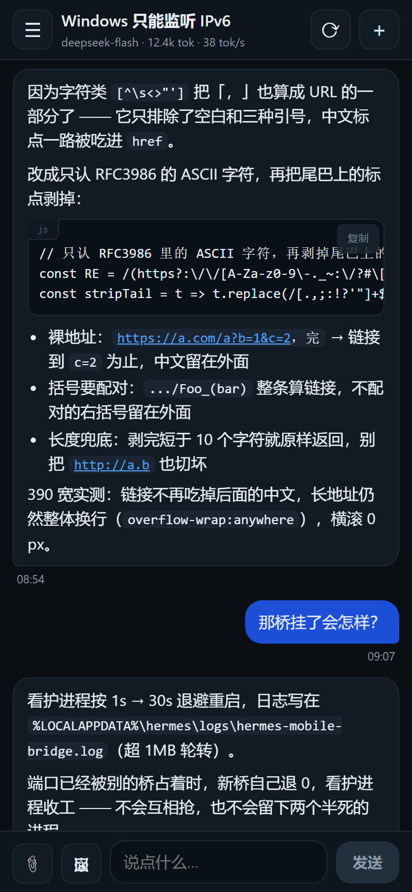

# Hermes Mobile

把电脑上正在跑的 [Hermes](https://hermes-agent.nousresearch.com/) 会话搬到手机上：**一个单文件页面 + 一个可选的 Android 壳**。

手机打开就能看到电脑上所有会话（终端 / 桌面端 / 飞书 / QQ / 定时任务，同一个 state.db），点进去接着聊——不是复制一份、不是新开会话，就是同一个会话的另一块屏幕。

不是云服务，也没有中继：手机直连你自己电脑上的 dashboard（`--host "::" --port 9119`），中间只有一个 126 行的 IPv4 TCP 桥。

<p></p>

<sub>界面示意，示例数据；390×844 真视口截的。</sub>

```
index.html      手机页面：单文件、零依赖、零构建，深色、390 宽优先
start.cmd       启动器：写口令文件、起 dashboard、拉起 IPv4 桥的看护进程
ipv4_bridge.py  0.0.0.0:9119 → [::1]:9119 的纯 TCP 旁路
bridge_supervisor.py  等 dashboard 就绪再起桥、崩了退避重启、定时刷新地址
apk/            Android 壳（WebView）源码 + 不用 Gradle 的构建脚本
tools/          验证：页面的状态机 harness + 全量静态/真网关断言
docs/NOTES.md   工程笔记：每个坑的实测数字与取舍（改代码前先读）
```

## 它解决三个具体问题

**1. Windows 上没有 PTY。** 官方 dashboard 的 Chat 标签页是在 xterm.js 里跑 `hermes --tui`，Windows 原生 Python 没有 POSIX PTY，这页直接显示"请用 WSL2"。所以这个页面绕开 PTY，直接连 `/api/ws` 的 JSON-RPC：

```
session.list     → 会话列表          session.resume   → attach 到已有会话
session.history  → 完整历史          prompt.submit    → 发消息，事件流推回来
session.create   → 新对话
```

**2. IPv6 地址会漂。** 运营商/校园网 RA 下发的 IPv6 前缀几小时就换一次（实测 `PreferredLifetime` ≈ 4h）。页面不背地址：地址由 `refresh_addrs.ps1` 每 5 分钟写进 `addrs.json`，电脑上 `show_url.cmd` 一条命令复制到剪贴板，手机上长按返回键粘进去。

**3. 手机只有 IPv4，而 Windows 只监听 IPv6。** `--host "::"` 在 Windows 上带 `IPV6_V6ONLY=1`，`127.0.0.1` 一概拒绝。手机连电脑热点时只有 `192.168.137.1` 这条路，所以有了 `ipv4_bridge.py`：纯 TCP 管道，WebSocket 升级、取票、大帧原样穿过，gateway 看到的是 loopback。

## 快速开始（Windows）

前提：电脑上装了 Hermes（`hermes` 在 PATH 上）、Python 3。

```bat
:: 1. 起服务（首次会随机生成口令，落在仓库外，屏幕上不打印）
start.cmd

:: 2. 拿手机该连的地址（同时复制到剪贴板）
show_url.cmd
```

手机浏览器打开那条地址 → 输一次密码（用户名 `hermes`，密码在 `%LOCALAPPDATA%\hermes\keys\dashboard.pass`）→ 之后自动登录。

想装壳（体验更好：无地址栏、长按返回键换地址、外链交给系统浏览器）：

```bash
# 需要 JDK 17+ 和 Android SDK（ANDROID_SDK_ROOT），不需要 Gradle
bash apk/build.sh          # 产出 hermes-mobile.apk，用同一个 keystore 才能覆盖安装
```

开机自启：把 `runner.vbs` 的快捷方式放进 `shell:startup`。它先 `netstat` 查 `[::]:9119`，已在监听就直接退出（幂等），起窗口隐藏、输出全进 `dashboard.log`。

进程看护（推荐）：`start.cmd` 只在登录时跑一次。合盖过夜 / 待机恢复时整棵进程树可能一起死掉，没有任何东西会把它拉回来。`watchdog.ps1` 补这一层：

```powershell
powershell -NoProfile -ExecutionPolicy Bypass -File install_watchdog.ps1
```

- 三个触发器：登录 / 每 5 分钟 / 系统唤醒（Power-Troubleshooter EventID 1）。
- 判两行监听：缺 `[::]:9119` 起整链，只缺 `0.0.0.0:9119` 只起桥。
- 子进程全用 `Win32_ProcessStartup.ShowWindow=0` 起，桌面上不会闪黑框；日志在 `watchdog.log`（512 KB 滚动，不进仓库）。
- 路径全部从脚本自身目录推，仓库放哪都行。
- 卸载：`Unregister-ScheduledTask -TaskName 'Hermes Mobile Watchdog' -Confirm:$false`

## 功能

**对话** · 流式回复（按帧节流，长回答不卡）· 停止按钮（`session.interrupt`）· 工具调用卡片（点开展开参数与结果）· 长按复制整条 · 代码块一键复制 · 30 分钟以上自动插日期分隔线 · 每轮 `耗时 · token · tok/s`

**Markdown** 标题/粗斜/行内码/链接/引用/有序无序列表/**表格**（中文换行、列多自动横滚）/代码块（语言标签）/裸 URL/任务列表；三级缩进列表；`@image:` `@file:` 引用

**会话列表** · 搜索（标题/预览/来源）· 按时间分组 · cron 会话默认折叠 · ✕ 归档 · 默认 60 条 + 显示更多

**工具审批** · agent 要跑危险命令时手机弹橙卡：批准 / 本会话都批准 / 总是批准 / 拒绝。靠 `client.capabilities {server_requests:true}` 声明能力，断线重连会把没答的卡重放出来，不支持的请求立刻回 `-32601`

**图片与文件** · 相册/文件选择器多选 · 图片自动压到最长边 1600px / JPEG 0.85 · 任意文件 ≤ 10 MB（base64 走 WS，避开手机内存峰值）· 历史图走鉴权的 `/api/fs/download`，不用重启服务

**弱网** · 断线指数退避重连 + 15s 心跳 · 报错说人话（409/401/429/超时各一条中文）· 失败消息就地「↻ 重发」

**性能** · 会话历史本地缓存（IndexedDB，按服务端 `count` 判定命中，命中时一次 `session.history` 都不发）· 历史翻页 160 条一页且保留深度 · 图片预留尺寸（CLS 实测 +909px → 0）

页面**不发任何第三方请求**：没有 CDN、没有字体外链、没有埋点，所有字节都来自你自己电脑上的 dashboard。

完整清单和每条背后的实测数字见 [`docs/NOTES.md`](docs/NOTES.md)。

## 验证

验证有三档，从快到全：

```bash
npm test        # 40 条页面状态机断言（main 38 + login 2），~20s，需要本机 dashboard 在 9119 上
npm run verify  # 78 项全量：真打包 APK + 真网关真登录 + 上面 40 条 + 静态事实断言
```

还有一档更快的、哪里都能跑的：

```bash
npm run test:ci # 12 项纯静态：脚本语法 + md() 12 项行为 + 8 条最易回归的事实，秒级
```

`npm test` 用 Node 里手搓的 DOM 跑页面自己的脚本，覆盖流式、断线、事件过滤、markdown 规则、长按容差、翻页补偿这些**行为**；它要真的登录 `http://localhost:9119`、拉会话、发帧，所以**必须有正在跑的 dashboard**，进不了 CI。

`npm run test:ci` 是 `node tools/verify_static.js`：只读 `index.html`，把内嵌脚本丢给 `vm.Script` 编译一遍、把 `md()` 抠出来跑 12 个用例、再核几条最容易回归的字符串（输入框高度、三级嵌套、事件过滤、socket 认身份、上传上限文案）。不连网关、不碰 Android SDK，任何平台都能跑，`.github/workflows/harness.yml` 跑的就是它。

`npm run verify` 是 `python3 tools/verify_all.py`，也是唯一能说"改完了"的那档，它会：

1. 用 `aapt2` + `javac` + `d8` + `apksigner` 真的把 `apk/` 编成 APK（`MainActivity.java` 的改动是真编进去的）；
2. 起真网关、真登录、跑两档 harness；
3. 对几十条静态事实做子串断言（viewport、触控热区、上传上限、事件过滤、发布卫生……）；
4. 最后一条是 **「验证的树 == 提交的树」**：源码必须已提交。所以顺序永远是 `git commit` → `verify`。

它需要 Windows + Android SDK + 正在跑的 dashboard，因此不进 CI；CI 只跑 `npm run test:ci` 与一把私密信息扫描（`.github/workflows/harness.yml`）。

## 安全模型（请读一下）

- **服务是公网可达的**：`--host "::"` 监听 `[::]:9119`，任何能连到这个地址的人都会看到登录页，**密码是唯一门槛**。只想本机用就把 `start.cmd` 里的 `--host "::"` 改成 `--host "::1"`；用完 `hermes dashboard --stop` 是最彻底的关门。
- **链路是明文 HTTP**，没有 TLS。密码和 cookie 在同网段可被嗅探——热点/家网/自己的 VPN 里用，别在公共 Wi-Fi 上开。
- **口令与私钥都不在仓库里**：`%LOCALAPPDATA%\hermes\keys\` 下四个文件（登录密码、会话签名密钥、APK 签名私钥及其口令），首次启动随机生成、只写不打印；`.gitignore` 挡一层，`verify_all.py` 还有一条「全仓没有旧口令残留」的断言盯着。
- **APK 没有默认密码**，装完第一次必须手输；它只内置一个通用候选地址（热点网关 `192.168.137.1`），机器名/CGNAT/隧道地址一律走应用内「改地址」存 prefs。
- **`/assets/` 这个前缀在 `dashboard_auth` 里免鉴权**，所以仓库里不放任何非公开素材；历史图片走要 cookie 的 `/api/fs/download`。
- 登录有 10 次 / 60 秒的限流（Hermes 网关侧）。

## 已知限制

- 协议是照 Hermes 的 `/api/ws` JSON-RPC 契约写的（2026-11 的 1.2 版 dashboard）：字段或方法名变了要跟着改，`docs/NOTES.md` 里记了每个调用的用途。
- `md()` 是一百多行手写正则管道，不是 CommonMark：不支持代码高亮、脚注、定义列表、HTML 内嵌、`####` 以下的标题。
- `session.history` 不分页（传 `limit` 会被忽略），大会话一次拉 1 MB 上下；缓存缓解，但没有根治。
- 历史缓存和草稿都按 **origin** 存，换个地址连（前缀变了、热点换校园网）就不通用。
- 启动脚本只有 Windows 版（`start.cmd` / `.ps1` / `.vbs`）；页面本身是纯静态的，任何能跑 Hermes dashboard 的系统都能用，只是要自己写启动脚本。
- 图片响应没有 `Cache-Control`（在 Hermes 核心的 `FileResponse` 里），只有 ETag/Last-Modified。
- 没有 iOS 壳。Safari 加主屏幕可用，但没有"长按返回键换地址"这类壳能力。

## 许可

[MIT](LICENSE)。
